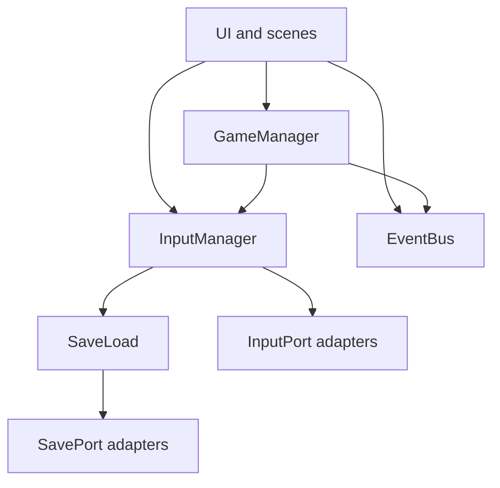

# Architecture

## Constructor + adapter

Anything that may swap backends (input, save, audio, platform APIs) follows:

1. **Port** — contract the game needs.
2. **Adapter** — one thin implementation.
3. **Factory** — picks and wires the adapter.

Gameplay and UI depend on the port, never on a concrete service scattered through the tree. New backend = new adapter + factory choice. Business rules stay outside adapters.

Domain interactions themselves follow **IDTCS** (Input → Detection → Transform → Communication → State). See [idtcs-pattern.md](idtcs-pattern.md). If any axis is unclear, ask the human before coding.

```
# yes
SaveFactory.make_default() -> SavePort
InputFactory.make(scheme) -> InputPort

# no
FileAccess.open(...) inside a menu
InputMap.add_event(...) inside the player
```

| Domain | Port | Factory | Adapters today |
| --- | --- | --- | --- |
| Input | `input/input_port.gd` (`InputPort`) | `InputFactory` | Keyboard, Mix, Gamepad, Touch |
| Save | `save/save_port.gd` (`SavePort`) | `SaveFactory` | `FileSaveAdapter` |
| Audio | — | — | Not ported yet (`AudioManager` stub) |
| Player stats | — | — | Not ported yet (`PlayerStats` stub) |

Project rules: root [`RULES.md`](../RULES.md) and [`.cursor/rules/english-clean-architecture.mdc`](../.cursor/rules/english-clean-architecture.mdc).

## Autoloads

Registered in [`project.godot`](../project.godot):

### `EventBus` — `autoload/EventBus.gd`

Thin pub/sub. No game logic.

| Signal | Status |
| --- | --- |
| `player_dashed` | Emitted by `player.gd`; listened by `game.gd` (scroll boost start) |
| `player_dash_ended` | Emitted by `player.gd`; listened by `game.gd` (scroll boost end) |
| `player_jumped` | Emitted by `player.gd`; no listeners yet |
| `scene_changed(path)` | Emitted by `GameManager.change_scene`; listened by `InputManager` (touch overlay) |
| `coin_collected(amount)` | **Reserved** — emitted by `GameManager.add_coins`; no callers / listeners yet |
| `player_died` | **Reserved** — until death / fail flow exists |

### `GameManager` — `autoload/GameManager.gd`

Run state and scene navigation.

- **State:** `current_world`, `current_phase`, `coins`, `records`, `is_running`, `pending_screen_title`, `IS_DEV_BUILD`
- **API:** `change_scene`, `open_under_construction`, `go_main_menu`, `go_control_settings`, `go_level_select`, `start_run`, `end_run`, `add_coins`
- `start_run` / `end_run` toggle `is_running` and call `InputManager.sync_input_map(true/false)` so play uses exclusive scheme bindings. Sole `start_run` call site: `game._ready`.

### `InputManager` — `autoload/InputManager.gd`

Owns the active exclusive scheme, applies bindings to Godot `InputMap`, touch overlay, and persistence under SaveLoad key `"input"`. See [input-system.md](input-system.md).

### `SaveLoad` — `autoload/SaveLoad.gd`

Facade over `SavePort`. Domain code uses `get_value` / `set_value`. See [save-system.md](save-system.md).

### `AudioManager` — `autoload/AudioManager.gd`

Stub (empty Godot template). Future candidate for an AudioPort stack.

### `PlayerStats` — `autoload/PlayerStats.gd`

Stub. Future candidate for run/session stats.

## Naming conventions

- **English only** for code, comments, UI strings, docs, commits.
- Prefer clear names over abbreviations.
- Ports / adapters / factories use `class_name` (`InputPort`, `FileSaveAdapter`, `SaveFactory`, …).
- Autoload file name matches singleton name (`GameManager.gd` → `GameManager`).
- Scenes: `PascalCase.tscn` next to `snake_case.gd` scripts.
- Shared action strings via `InputActions`, not raw keys in gameplay.

## Layering sketch


