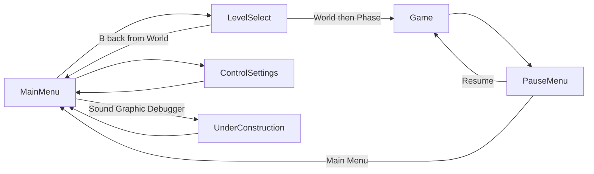

# Scene flow

Navigation is owned by `GameManager`. Scenes change via `change_scene_to_file`; every change also emits `EventBus.scene_changed`.

## Flow

- **Start** on Main Menu → Level Select (World ring → Phase ring) → Game.
- **Controls** opens Control Settings; back returns to Main Menu.
- **Sound / Graphic / Debugger** open `UnderConstruction` with a title (`GameManager.open_under_construction`). Debugger is shown only when `GameManager.IS_DEV_BUILD` is true.
- **Pause** (`btn_start`): Resume or Main Menu (`end_run` + `go_main_menu`).

## Scene / script map

| Scene | Script | Role |
| --- | --- | --- |
| `scenes/app/MainMenu.tscn` | `main_menu.gd` | Title; Start / Sound / Graphic / Controls / Debugger |
| `scenes/select/LevelSelect.tscn` | `level_select.gd` | Clock ring World → Phase; dive into Game |
| `scenes/select/CarouselItem.tscn` | `carousel_item.gd` | Ring slot visual |
| `scenes/run/Game.tscn` | `game.gd` | Scroll world, camera, `start_run` |
| `scenes/run/Player.tscn` | `player.gd` | Jump / dash `CharacterBody2D` |
| `scenes/run/PauseMenu.tscn` | `pause_menu.gd` | Start toggle; Resume / Main Menu (`PROCESS_MODE_ALWAYS`) |
| `scenes/app/ControlSettings.tscn` | `control_settings.gd` | Remap schemes |
| `scenes/hud/TouchControls.tscn` | `touch_controls.gd` | On-screen pad (autoload child of InputManager) |
| `scenes/app/UnderConstruction.tscn` | `under_construction.gd` | Placeholder screens |

## GameManager scene constants

From [`autoload/GameManager.gd`](../autoload/GameManager.gd):

| Constant | Path |
| --- | --- |
| `SCENE_MAIN_MENU` | `res://scenes/app/MainMenu.tscn` |
| `SCENE_LEVEL_SELECT` | `res://scenes/select/LevelSelect.tscn` |
| `SCENE_GAME` | `res://scenes/run/Game.tscn` |
| `SCENE_CONTROLS` | `res://scenes/app/ControlSettings.tscn` |
| `SCENE_UNDER_CONSTRUCTION` | `res://scenes/app/UnderConstruction.tscn` |
| `SCENE_SOUND` / `SCENE_GRAPHIC` / `SCENE_DEBUGGER` | same UnderConstruction scene |

Helpers: `go_main_menu()`, `go_level_select()`, `go_control_settings()`, `open_under_construction(title)`, `change_scene(path)`.

## Run lifecycle

1. Entering Game `_ready` calls `GameManager.start_run()` → `is_running = true` → InputMap becomes play-exclusive.
2. Leaving via pause → Main Menu calls `end_run()` so menus regain keyboard/MIX UI bindings.
