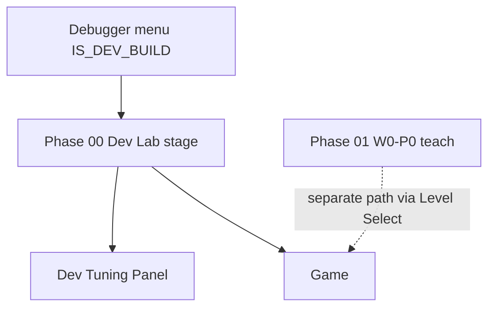

# Spec LD-00 — Dev Lab (Phase 00) + Tuning Panel

**Status:** Spec documented; **MVP implemented** (Debugger → lab + Tuning Panel)  
**Audience:** Developers only (`GameManager.IS_DEV_BUILD`)  
**Owner domain:** Run tooling (`stages/dev/`, future `scenes/run` / `scenes/hud` debug UI)  
**Depends on:** run loop, [LD-01](LD-01-level-design.spec.md), [hitstop.md](../hitstop.md), [reactive-sounds.md](../reactive-sounds.md), IDTCS  
**Brainstorm:** [phases/phase-00-dev-lab/brainstorm.md](phases/phase-00-dev-lab/brainstorm.md)

## Purpose

Phase **00 Dev Lab** is a **sandbox stage** that eventually contains **every mechanic Cubu Dash can do**, laid out as a catalog strip for testing, regression, and **feel fine-tuning** until numbers and juice feel locked.

It is **not** a player-facing World/Phase. Player teach content remains Phase 01 (W0-P0). Dev Lab is parallel tooling so designers/devs can iterate without fighting the teach-beat order of the real first phase.

## Relationship to LD-01 pipeline

| LD-01 sequence | Dev Lab role |
| --- | --- |
| S0–S1 vocabulary + loader | Lab uses the same stage format under `stages/dev/` |
| S2 W0-P0 teach | Lab does **not** replace it |
| S3+ hazards / hitstop / fail | Lab **gains zones** as each system lands — stubs OK until then |
| Release builds | Lab entry stripped when `IS_DEV_BUILD == false` |



## Entry points

| Entry | Requirement |
| --- | --- |
| **Debugger** main-menu button | When implemented: leave UnderConstruction; load Dev Lab / Game with lab stage |
| Hotkey from menus/run | Optional later — **undecided**; ask before inventing |

Never appear in Level Select rings for players.

## Stage identity

- Path target: `stages/dev/phase_00_lab` (or equivalent descriptor)
- **Not** `(world_id=0, phase_id=0)` — that slot stays NEON CUBES Phase 1 for players
- May set a `GameManager` flag such as `is_dev_lab_run` (name locked at implement time) so Game loads the lab descriptor

## Lab stage requirements

One long **catalog strip** (scroll toward the player) with labeled zones. As systems ship, zones become live; until then placeholders (signs / colored pads) are enough.

Minimum catalog zones (see brainstorm for beat detail):

| Zone | Exercises |
| --- | --- |
| Jump | Single jump gaps / low blocks |
| Double jump + Light hitstop | High gap + heavier land |
| Dash | Open dash lane |
| Breakable + Medium hitstop | Dash destroys crate |
| Hard wall + Strong hitstop | Immovable smash / fail or stun |
| Coin / pickup | Collect without fail |
| Fail | Fair death / restart hook |
| Clear | End marker |

Global run tunables (scroll, dash multiplier, camera look-ahead, jump force, hitstop tiers) must be adjustable from the **Dev Tuning Panel** without rebuilding the stage.

## Dev Tuning Panel

### Goal

Corner overlay that shows **live configurable data** for the **selected** game object (and/or global run services), editable in play so fine-tuning does not require restarting the editor for every tweak.

### Requirements

| ID | Requirement |
| --- | --- |
| DTP-01 | Panel is a `CanvasLayer` (or equivalent) with `PROCESS_MODE_ALWAYS` so it works while the tree is paused |
| DTP-02 | Collapsed **tab** in a screen corner; **mouse click** expands/collapses at any time during the lab run |
| DTP-03 | Expanded panel lists tunable fields of the current selection; edits apply **immediately** to the live instance |
| DTP-04 | Prefer binding documented `@export` / known tunables (Player jump/dash, Game scroll/camera, future Hitstop tiers) |
| DTP-05 | Selection: **click object in-world** and/or **picker list** of known targets — exact combo locked at implement; if unclear, **ask** |
| DTP-06 | Mouse owns panel chrome; gameplay pause (`btn_start`) must not block opening/editing the panel |
| DTP-07 | Panel chrome does **not** require `# TODO: AUDIO` (tooling UI); game impacts still follow reactive-sound rules |
| DTP-08 | When `IS_DEV_BUILD == false`, panel and lab entry are absent |

### IDTCS — open / edit panel

```text
INPUT:         mouse click on tab / fields (even while paused)
DETECTION:     hit-test tab or selected node / picker choice
TRANSFORM:     panel open state; write property values on target
COMMUNICATION: N/A or optional debug-only bus — not player EventBus spam
STATE/LOGIC:   panel_open bool; selected_node ref; apply on edit
```

### IDTCS — select game object (when using click-select)

```text
INPUT:         mouse click in world (lab only)
DETECTION:     physics/area pick under cursor
TRANSFORM:     highlight selected; panel rebinds fields
COMMUNICATION: N/A
STATE/LOGIC:   selected_node = picked; ignore clicks on panel rect
```

## Out of scope (this spec / lab)

- Shipping lab or panel in release builds
- Replacing Phase 01 teach design
- Final art, BGM, or inventing numeric “perfect” defaults in docs
- Online multiplayer debug

## Acceptance

### Docs (this pass)

- [x] LD-00 spec written
- [x] Phase 00 brainstorm written
- [x] Cross-linked from LD-01, docs index, current-status, hitstop

### Implementation (MVP)

- [x] Debugger opens Dev Lab instead of UnderConstruction (dev builds)
- [x] Lab catalog stubs build from `stages/dev/phase_00_lab.gd`
- [x] Tuning panel meets DTP-01–DTP-04, DTP-06–DTP-08 (picker targets; in-world click select later)
- [x] Player + Game scroll/camera exports editable live
- [x] Catalog zone markers A–H present (stubs)
- [ ] In-world click selection (DTP-05 full)
- [ ] Live Hitstop tier fields when Hitstop service exists

## Related

- [phases/phase-00-dev-lab/brainstorm.md](phases/phase-00-dev-lab/brainstorm.md)
- [LD-01-level-design.spec.md](LD-01-level-design.spec.md)
- [phases/phase-01-first-run/brainstorm.md](phases/phase-01-first-run/brainstorm.md)
- [../hitstop.md](../hitstop.md), [../gameplay.md](../gameplay.md)
